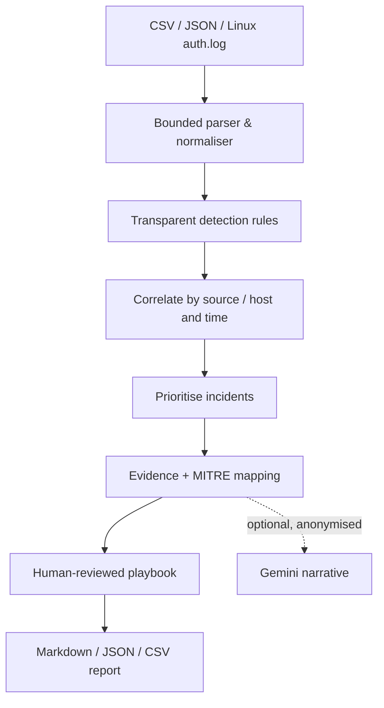

# AegisTrace

**AI-Powered Security Operations & Threat Triage Agent** · PromptWars X Agent X 2.0 · **PS06: AI-Powered Cybersecurity Triage**

AegisTrace is a local-first defensive security triage agent. It ingests Windows security-event exports and Linux authentication logs, normalises events, detects suspicious authentication and privilege patterns, correlates related evidence into incidents, ranks risk, and prepares safe investigation playbooks for a human analyst.

> **Core safety promise:** AegisTrace is advisory only. It does not block IP addresses, disable accounts, terminate sessions, modify endpoints or make firewall changes. A detection is an investigative lead—not proof of compromise.

## Why it matters

Small IT teams often receive scattered authentication and account-management events without a dedicated Security Operations Centre (SOC). AegisTrace turns several low-level records into a short incident queue with the evidence, confidence, MITRE ATT&CK reference and next investigation steps visible together.

## Run it

### 1. Requirements

- Python 3.10+
- Streamlit and Pandas (installed from `requirements.txt`)
- Optional: a Gemini API key for the opt-in analyst narrative; the core application does not require one

### 2. Install and launch

```bash
python -m venv .venv
# Windows PowerShell
.\.venv\Scripts\Activate.ps1
# macOS / Linux
source .venv/bin/activate

python -m pip install -r requirements.txt
streamlit run app.py
```

Open the local URL printed by Streamlit. The synthetic multi-signal demo is loaded automatically. Use the left sidebar to switch scenarios or upload your own file.

### 3. Optional Gemini narrative

```bash
python -m pip install -r requirements-ai.txt
```

Set `GEMINI_API_KEY` in your environment or enter it in the optional AI Analyst panel. The integration is deliberately opt-in. It sends only aggregate counts, detection rule IDs, severity, confidence and evidence counts. It does **not** send raw log messages, usernames, IP addresses or hostnames. The local detection engine remains the source of truth.

You can override the model with `GEMINI_MODEL`. The default is `gemini-3.8-flash`; use a model enabled for your Google AI Studio project.

## What it detects

| Rule | Signal | Default severity | MITRE ATT&CK |
|---|---|---:|---|
| `AUTH_BRUTE_FORCE` | At least 5 failed sign-ins for one account from one source in 10 minutes | High | T1110.001 |
| `AUTH_PASSWORD_SPRAY` | At least 8 failures against 5 or more accounts from one source in 15 minutes | High | T1110.003 |
| `AUTH_SUCCESS_AFTER_FAILURE` | At least 5 failures followed by a successful sign-in for the same account/source within 15 minutes | Critical | T1110 |
| `PRIVILEGED_LOGIN` | Windows special-privilege logon or Linux sudo/root activity | Medium | T1078 |
| `AUDIT_LOG_CLEARED` | Windows Security event 1102 or equivalent message | Critical | T1070.001 |
| `GROUP_MEMBERSHIP_CHANGE` | Windows security-group membership addition | High | T1098 |
| `ACCOUNT_CREATED` | New local/domain account creation | Medium | T1136 |
| `ACCOUNT_LOCKOUT_BURST` | 3 or more account-lockout events on one host within 10 minutes | Medium | T1110 |

These are transparent starter heuristics, not a replacement for tuned SIEM analytics. Thresholds are explicit in `aegistrace/rules.py` and should be adapted to each environment. Priority scores and confidence labels are heuristic indicators, not calibrated probabilities. A privileged logon alone is treated as review context (Medium), not proof of malicious activity.

## Supported inputs

- **CSV:** generic security-event exports and Windows Event Viewer CSV exports. Common column variants are recognised, including `TimeCreated`, `EventID`, `TargetUserName`, `IpAddress`, `Computer` and `Message`.
- **JSON / JSONL:** object, array or `events` / `records` / `data` array structures.
- **Linux `.log` / `.txt`:** common `sshd` failed/accepted password lines, invalid-user events, PAM authentication failures, sudo commands, root session openings and `useradd` entries.

Upload limits are 5 MB and 20,000 records. Unknown event types are retained and surfaced as warnings rather than silently discarded. Records without parseable timestamps remain visible but are excluded from time-window correlation. **Timezone note:** timezone-aware ISO timestamps are converted to UTC; timezone-naive timestamps are interpreted as UTC. Traditional syslog timestamps do not carry a year or timezone, so the parser assigns the current UTC year. Normalise your source timezone/year before exact cross-system correlation.

## Agent workflow



The pipeline is intentionally deterministic for ingestion, detection, severity and response recommendations. The optional LLM only creates a narrative summary and cannot modify findings or call response tools.

## Demo walkthrough

1. Start the app and keep **Full multi-signal simulation** selected.
2. Point out the password-spraying incident from `198.51.100.24`.
3. Open the `203.0.113.77` incident: five failed logins are followed by a successful administrator login and privileged activity.
4. Show the security-group change and audit-log-clearing incidents.
5. Expand an incident to show the source records, MITRE technique, confidence and investigation playbook.
6. Export the Markdown and JSON reports. Explain that the app never performs destructive remediation.
7. Optional: demonstrate Linux ingestion with `sample_data/linux_auth.log`.

All demo IPs are from documentation-only address ranges (RFC 5737) and all user/device names are synthetic.

## Tests

Run the standard-library test suite:

```bash
python -m unittest discover -s tests -v
```

The tests cover CSV/JSON/Linux ingestion, upload limits, brute-force detection, password spraying, success-after-failure, audit-log clearing, incident correlation and exports.

## Repository / deployment notes

- Kept the repository **public** for judging.
- Kept only one `main` branch.
- Repository content is intentionally small; do not commit virtual environments, uploaded customer logs, API keys or generated reports containing real security data.
- A `Dockerfile` is included for Google Cloud Run. Follow [`CLOUD_RUN_DEPLOYMENT.md`](CLOUD_RUN_DEPLOYMENT.md) to deploy in `asia-south1` and obtain the actual public Service URL required by the competition form.
- The container listens on the `PORT` environment variable provided by Cloud Run and runs as a non-root user.
- The app works without secrets; set `GEMINI_API_KEY` only if you want the optional Gemini feature. The main demo does not need an API key.

## Security and privacy

- Uploaded files are decoded and parsed as data; they are never executed.
- No database or remote log storage is used by the app. When deployed to a hosted service, uploaded logs and any key entered in the UI pass through that host runtime even though the app does not persist them; use synthetic data for public demos and a trusted local run for sensitive logs. Downloaded reports can contain usernames, source IPs, hostnames and raw event messages; treat exports as confidential and never commit production reports to the public repository.
- The core workflow makes no network calls.
- Optional Gemini use requires an explicit consent checkbox and sends anonymised aggregate incident metadata only.
- API keys should be stored in environment variables or the hosting platform's secret manager, never in source control.
- This prototype does not claim production-grade SIEM coverage, forensic integrity, threat attribution or false-positive-free detection.

See [THREAT_MODEL.md](THREAT_MODEL.md), [SECURITY.md](SECURITY.md), [AI_USAGE.md](AI_USAGE.md) and [DEMO_SCRIPT.md](DEMO_SCRIPT.md).

## References

- Microsoft Learn — [Audit logon events](https://learn.microsoft.com/windows/security/threat-protection/auditing/basic-audit-logon-events)
- Microsoft Learn — [Event 4624: successful logon](https://learn.microsoft.com/windows/security/threat-protection/auditing/event-4624)
- MITRE ATT&CK — [Brute Force (T1110)](https://attack.mitre.org/techniques/T1110/)
- MITRE ATT&CK — [Password Spraying (T1110.003)](https://attack.mitre.org/techniques/T1110/003/)
- MITRE ATT&CK — [Clear Windows Event Logs (T1070.001)](https://attack.mitre.org/techniques/T1070/001/)
- MITRE ATT&CK — [Account Manipulation (T1098)](https://attack.mitre.org/techniques/T1098/)
- Gemini API — [Models](https://ai.google.dev/gemini-api/docs/models)

## License

MIT. See [LICENSE](LICENSE).
